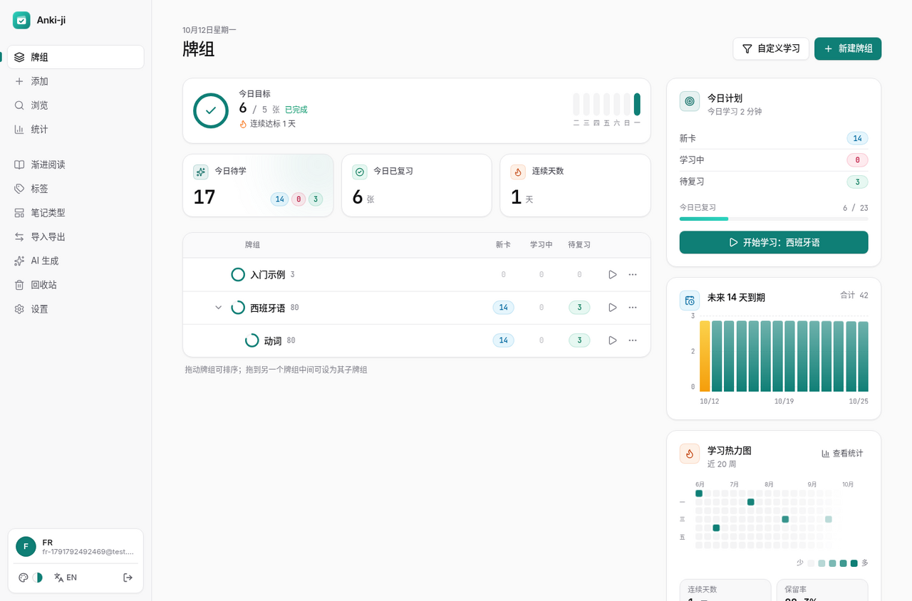
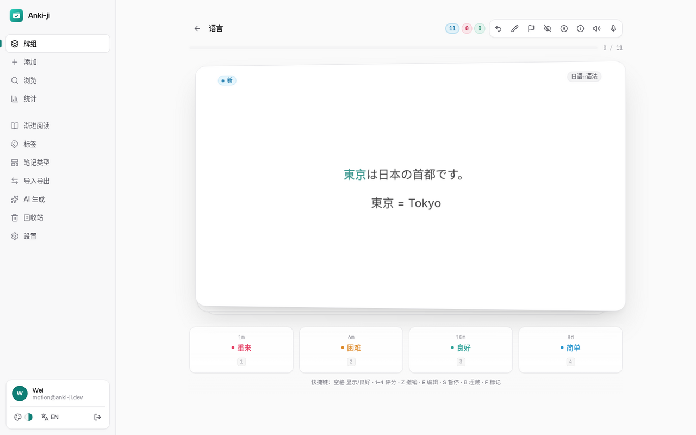
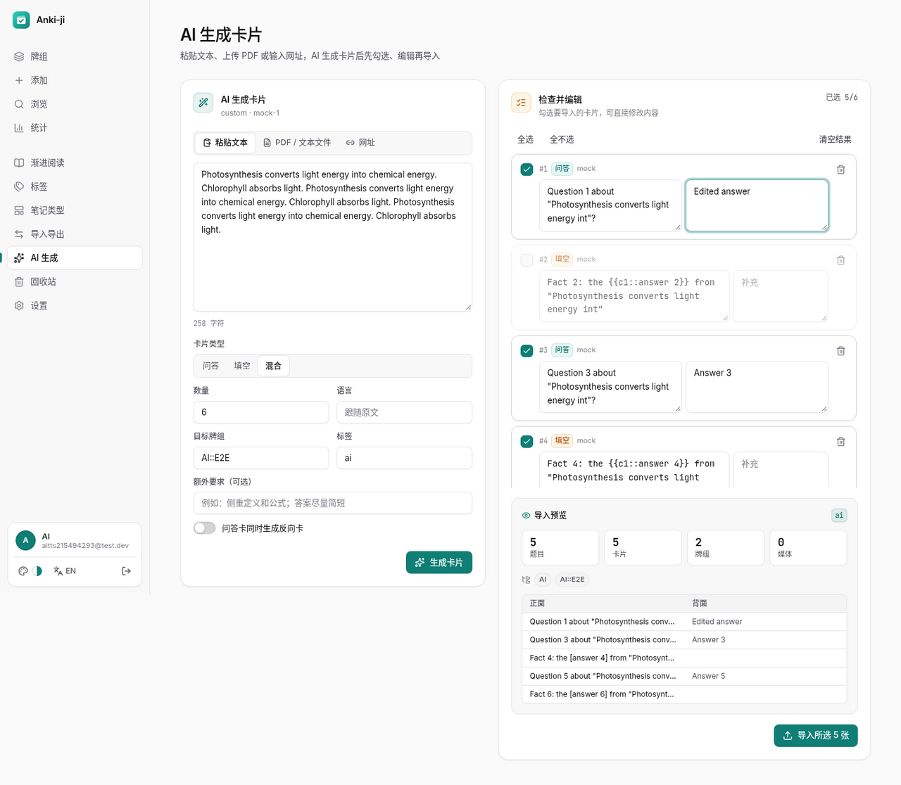
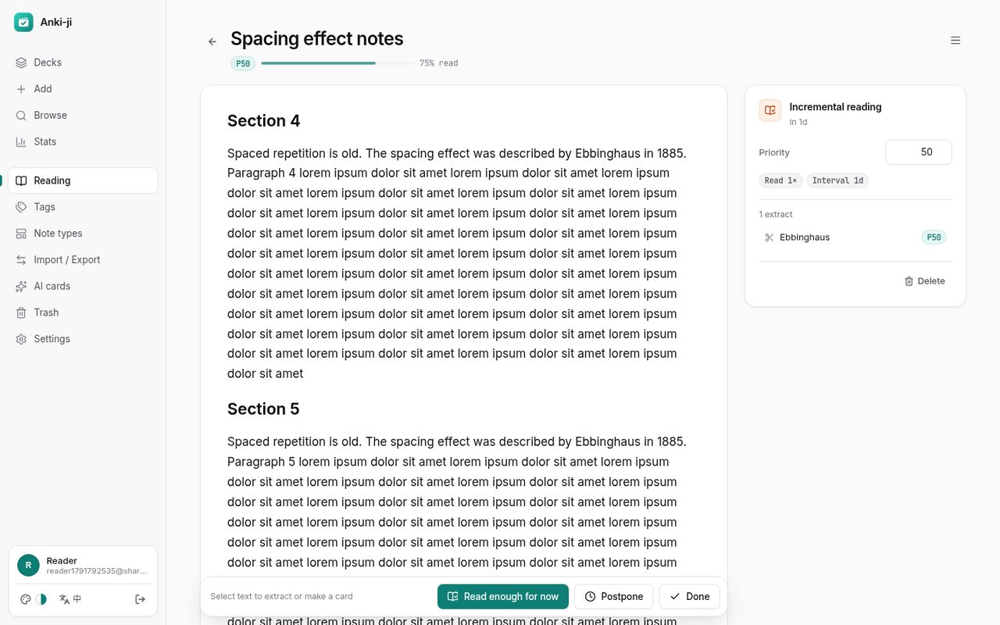
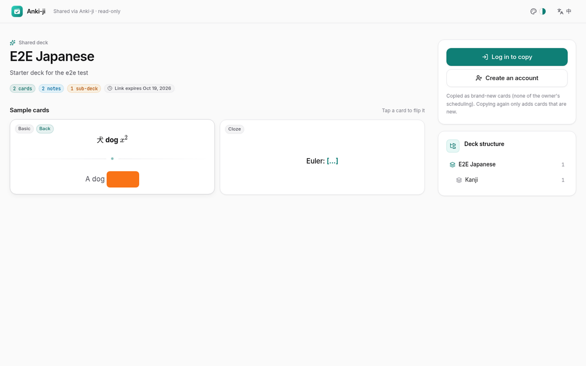
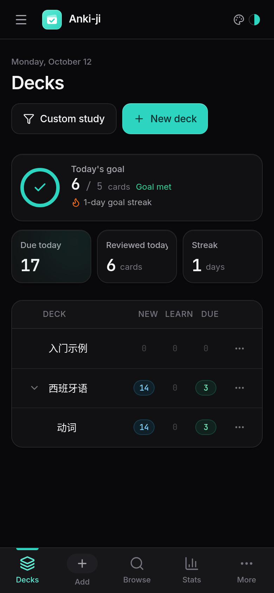
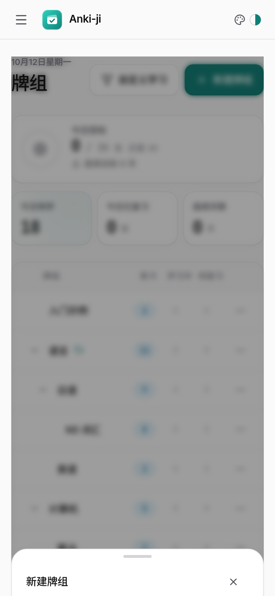
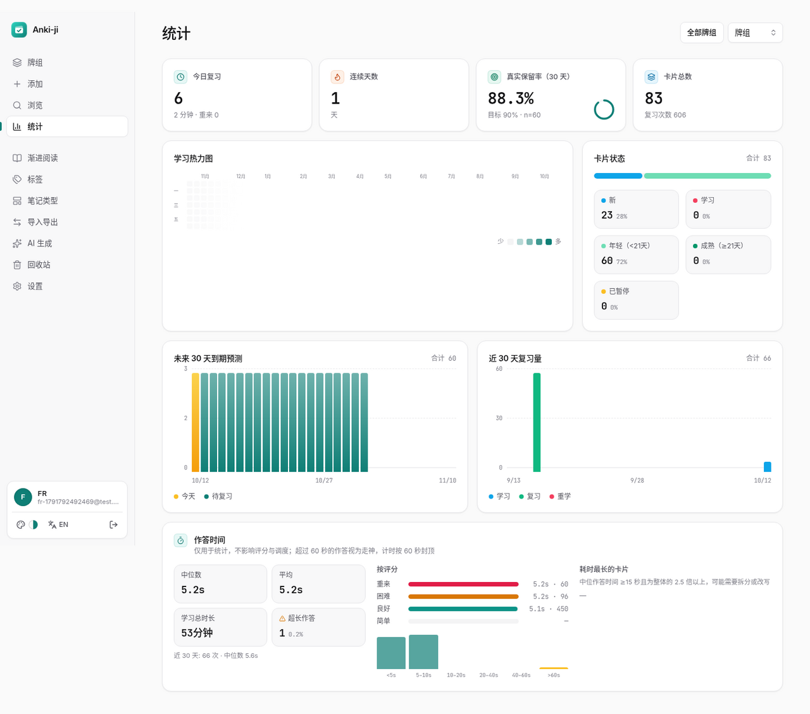

<div align="center">

# Anki-ji

**打开浏览器就能用的 Anki。复习算法和 Anki 一样，体验按现代 App 的标准来做。**

FSRS-6 调度 · 自定义笔记类型 · AI 出卡 · 离线复习 · 与 Anki 双向互通

[**在线体验 → anki-ji.vercel.app**](https://anki-ji.vercel.app) · 免安装 · 电脑 / 平板 / 手机通用 · 中文 / English



</div>

---

## 为什么选 Anki-ji？

Anki 的记忆算法很强，但上手门槛也高：要装桌面端、要配同步，界面也停留在十年前。Quizlet 好上手，可它不做科学的间隔重复，学过的东西很快就忘。

Anki-ji 把两边的长处放到一起：

| | Anki 桌面版 | Quizlet | **Anki-ji** |
|---|---|---|---|
| 科学调度（FSRS） | ✅ | ❌ | ✅ FSRS-6，并能**自动**用你的记录训练参数 |
| 免安装、多端同步 | ❌ 需装客户端并配同步 | ✅ | ✅ 打开网页即用，数据云端保存 |
| 离线复习 | ✅ | 付费 | ✅ 断网照常复习，联网自动合并 |
| 自定义模板 | ✅ | ❌ | ✅ 兼容 Anki 模板语法 |
| AI 出卡 | 插件 | 付费 | ✅ 自带 Key，粘贴文本 / PDF / 网址即可 |
| 测验 / 配对 / 拼写 | ❌ | ✅ | ✅ 不影响记忆调度 |
| 渐进阅读 | ❌ | ❌ | ✅ |
| 与 Anki 互通 | — | ❌ | ✅ `.apkg` 导入导出 + AnkiConnect API |
| 现代界面与动效 | ❌ | ✅ | ✅ 7 套主题、响应式、细致动效 |

---

## 30 秒上手

1. 打开 [anki-ji.vercel.app](https://anki-ji.vercel.app)，用邮箱注册。新账号自带示例牌组，可以直接开始。
2. 已经在用 Anki？把 `.apkg` 拖进「导入导出」页，复习进度会一起带过来。
3. 手上只有资料？在「AI 生成」里粘贴一段文字、上传 PDF 或填一个网址，几秒后勾选需要的卡片导入。
4. 每天打开「牌组」，点「开始学习」。空格翻面，按 1–4 评分，手机上也可以左右滑动。

---

## 功能全景

### 🧠 记得更牢：调度与复习



| 功能 | 价值 | 亮点 |
|---|---|---|
| **FSRS-6 调度**（另有 SM-2、Leitner 可选） | 在快要忘记的时候提醒你复习，同样记住一张卡，复习次数比固定间隔少得多 | 采用官方 `ts-fsrs`，测试逐步比对官方实现，结果完全一致 |
| **参数自动优化** | 算法会越用越懂你的记忆规律，不需要手动调参 | 复习记录攒够后在后台用官方 fsrs-rs 训练；只有新参数确实更准（log-loss 下降）才采用；每个版本都有记录，可以一键回退 |
| **保留率模拟器** | 回答“目标记忆率设多少最划算”：设 90% 和 95%，每天各要复习多少张？ | 模拟未来 365 天的工作量和掌握量，给出推荐值，拖动滑块即时出图 |
| **智能每日安排** | 每天的量稳定，不会突然堆出几百张 | 负载均衡、轻松日、兄弟卡埋藏、顽固卡（Leech）自动处理；按你所在时区，凌晨 4 点切换学习日 |
| **每日目标与连续天数** | 给自己一个看得见的小目标，更容易坚持 | 按卡片数或分钟数设定，主页显示进度环和连续天数 |
| **复习提醒** | 到点提醒，有卡要复习才打扰你 | Web 推送（电脑 / 安卓 / iOS 加到主屏幕后），可设时间，没有到期卡就不发 |
| **作答用时统计** | 找出那些“想很久才想起来”的卡片 | 用时分布、按评分统计、最慢卡片列表 |

### ✍️ 做卡更快：内容创作



| 功能 | 价值 | 亮点 |
|---|---|---|
| **AI 生成卡片** | 一章教材、一篇论文、一个网页，几秒变成一组卡片 | 支持 OpenAI、DeepSeek、Moonshot、OpenRouter、Ollama、Anthropic 等；问答、填空或混合出题；生成后逐张勾选、编辑再导入；你的 Key 加密存储，页面上只显示末 4 位 |
| **自定义笔记类型与模板** | 单词卡、语法卡、病例卡都能按自己的格式设计，一条笔记自动生成多张卡 | 兼容 Anki 模板语法（`{{Field}}`、`{{FrontSide}}`、`{{cloze:}}`、`{{type:}}`、条件段落等）；编辑时实时预览；模板 CSS 只作用于卡片内部，不会影响页面 |
| **丰富题型** | 适合不同类型的知识点 | 基础 / 反向 / 填空（可嵌套、带提示）/ 输入作答（逐字比对）/ 选择题 / 图片遮挡 |
| **富文本内容** | 公式、代码、图片、音视频都能放进卡片 | Markdown、KaTeX、代码高亮、图片音频上传、B 站 / YouTube 嵌入；所有内容都经过安全净化 |
| **朗读与录音** | 学语言时听发音、练口语 | 自动朗读正面或背面，可选语言、音色、语速（按牌组或笔记类型分别设置，R 键朗读）；录下自己的发音和原音对比，也可以直接插入卡片 |
| **划词收集插件** | 看网页时遇到生词或好句子，右键就能做成卡 | Chrome / Edge 扩展：右键「添加到 Anki-ji」或按 Alt+Shift+A，自动带上来源链接，可选牌组、标签，也能做填空 |

### 📚 学得更活：多种学习方式



| 功能 | 价值 | 亮点 |
|---|---|---|
| **测验模式** | 考前突击，检验自己是否真的掌握 | 选择题、判断题、填写题混合出题，干扰项优先挑形近的；出成绩单，可只重做错题 |
| **配对游戏** | 用游戏的方式快速过一遍 | 计时，每个牌组记录最佳成绩 |
| **拼写模式** | 练单词和术语的拼写 | 逐字比对，答错的卡片回到队尾，直到答对 |
| **渐进阅读** | 长文章不用一口气读完；边读边摘录，再把重点变成卡片 | 文章自己也按间隔重复排期，按优先级排队；选中文字即可摘录，或直接生成问答卡、填空卡；记住上次读到的位置 |

> 测验、配对、拼写都是额外练习，**不会影响**正式的记忆调度和复习记录。

### 🗂️ 管得更省心：整理与维护

| 功能 | 价值 | 亮点 |
|---|---|---|
| **无限层级牌组 + 层级标签** | 按学科、章节组织成千上万张卡 | 拖拽排序和嵌套；`a::b` 层级标签 |
| **强大的浏览器** | 快速找到任何一张卡 | 支持 Anki 风格搜索语法，可批量移动、加标签、暂停、重置；侧边实时预览 |
| **查找替换** | 一次改掉成百上千张卡里的同一处错误 | 可限定字段，支持正则和区分大小写；应用前预览匹配数和前后对比；可撤销 |
| **重复检测与合并** | 多次导入的资料，一键清理重复 | 按牌组 / 笔记类型 / 全库查找；合并时保留一条并合并标签，可沿用复习最多那张卡的进度；可撤销 |
| **批量更换笔记类型** | 比如把一批基础卡升级成“基础 + 反向” | 字段映射对话框，预览会新增、删除多少张卡；可撤销 |
| **自定义学习 / 过滤牌组** | 考前集中复习某一部分 | 例如用 `is:due prop:due<=3` 提前复习 3 天内到期的卡 |
| **回收站** | 误删也不怕 | 牌组和卡片都能恢复 |

### 🔄 进出自由：导入、导出与互通



| 功能 | 价值 | 亮点 |
|---|---|---|
| **导入几乎所有来源** | 从别的工具搬家不用从零开始 | Anki `.apkg` / `.colpkg`（含自定义模型和复习进度）、CSV / TSV / Excel、Markdown / Obsidian（含整个仓库）、Mochi、RemNote、Quizlet、SuperMemo、Mnemosyne、智能粘贴；导入前统一预览，重复导入自动去重 |
| **`.apkg` 导出** | 数据随时可以带走，回到 Anki 桌面版或 AnkiDroid | 可导出整库或某个牌组，可选是否带复习进度和媒体；FSRS 记忆状态和复习记录都会保留；已用官方 Anki 后端验证可以正常导入 |
| **AnkiConnect 兼容 API** | Yomitan 查词、各种脚本和工具都能直接往 Anki-ji 加卡 | 兼容 v6 协议，支持 addNote、findNotes、notesInfo、storeMediaFile、multi 等常用动作；个人令牌只存哈希，可以随时吊销 |
| **共享牌组** | 把整理好的牌组发给同学、团队或读者 | 只读链接，对方不用登录就能预览；一键复制到自己的账号（不带你的复习进度）；可设有效期，可撤回，能看到浏览和复制次数 |
| **完整备份** | 一个文件包含全部数据 | JSON 备份包括牌组、卡片、调度、复习记录、媒体，可以无损恢复 |

### 📶 随时随地：多端与离线

| 功能 | 价值 | 亮点 |
|---|---|---|
| **离线复习** | 地铁、飞机上也能刷卡 | 下载牌组后，断网也能打开并照常复习（使用同一套调度算法），支持撤销 |
| **自动同步** | 不用担心数据丢失或冲突 | 联网后自动上传；同一条记录不会重复提交；如果服务器上的卡片在此期间被改过，会按时间顺序重放复习记录再重新排期，复习记录完整保留 |
| **全端适配** | 一套账号，电脑、平板、手机都顺手 | 手机底部导航和抽屉、平板侧栏、宽屏仪表盘；按钮等点击区域不小于 44px |

### ✨ 用起来舒服：界面与动效

<p align="center">
  
  &nbsp;&nbsp;
  
</p>

- **复习动效**：显示答案时卡片 3D 翻面；评分后卡片按方向飞出并带颜色提示（重来向左偏红、良好向右、简单向上）；手机滑动时卡片跟手倾斜，接近阈值会提示评分，没滑够就弹回原位；撤销时卡片飞回来。
- **处处有反馈**：页面切换淡入、导航指示条平滑滑动、按钮按压回弹、弹窗在手机上变成可下拉关闭的底部面板、数字递增、图表生长、加载时显示骨架屏；切换主题时从点击位置圆形展开。
- **照顾每个人**：跟随系统的「减少动态效果」设置，也可以在设置里手动关闭动效。
- **7 套主题**：浅色、深色、金色、红黑、水墨、纸张、橙色。界面支持中文和英文。



---

## 质量与安全

- **测试驱动开发**：549 个 Vitest 测试，覆盖调度算法（逐步比对官方 FSRS）、离线同步合并、模板渲染、`.apkg` 导出后再导入的往返、AnkiConnect 各个动作、Web Push 加密（逐字节复现 RFC 8291 官方示例）、跨用户数据隔离等。
- **线上验收**：每次发布都对线上环境跑冒烟测试（39 项）和逐项功能验收（26 项），包括真实断网复习后联网同步。
- **数据隔离**：每条 SQL 都按用户过滤；跨用户访问在测试中验证返回 404。
- **安全**：所有卡片 HTML 经过 DOMPurify 净化，模板 CSS 只作用于卡片内部；密码用 bcrypt；AI Key 用 AES-GCM 加密；API 令牌只存哈希；抓取 URL 时拦截内网地址（防 SSRF）。

---

## 技术栈与架构

**Next.js 15（App Router）· TypeScript · Tailwind · Neon Postgres · Vercel Blob · Service Worker / IndexedDB · Vitest + PGlite**

```
src/
├─ core/       纯领域逻辑（不依赖框架和数据库，全部有单元测试）
│              调度器（FSRS / SM-2 / Leitner）· 队列 · 模拟器 · 模板渲染 · 离线同步合并
│              搜索语法 · 学习模式出题 · 批量编辑 · 渐进阅读排期 · 导入导出（io/）· 互通（interop/）
├─ server/     数据仓储与服务层（每条 SQL 都带 user_id）、建表脚本（schema/）、AI / 推送 / 加密
├─ app/        页面（薄 UI）与 /api 路由（薄控制器）
├─ components/ 组件与设计系统（ui.tsx、动效、主题）
└─ lib/        i18n、Markdown 渲染、客户端导入导出、TTS、录音
extension/     Chrome / Edge 划词插件（MV3）
public/sw.js   Service Worker（离线缓存 + 推送）
tests/         Vitest（核心逻辑 + 进程内真 Postgres）
```

**设计原则**：调度、队列、模板、导入导出等核心逻辑只在 `src/core` 实现一次，服务端、浏览器和离线模式共用同一份代码。例如离线复习调用的就是线上同一个调度器，`.apkg` 导入和 AI 生成走的也是同一条导入预览管线。

---

## 本地开发

```bash
npm install
cp .env.example .env.local   # 填写 DATABASE_URL、JWT_SECRET
npm run dev

npm test                      # 全部测试（机器内存小时可加 --maxWorkers=1）
npm run lint                  # ESLint + tsc
npm run build
npm run build:extension       # 打包浏览器插件到 public/anki-ji-extension.zip
BASE_URL=http://localhost:3000 node scripts/smoke.mjs   # 端到端冒烟测试
```

### 环境变量

| 变量 | 必需 | 用途 |
|---|---|---|
| `DATABASE_URL` | ✅ | Neon / Postgres 连接 |
| `JWT_SECRET` | ✅ | 登录会话签名 |
| `BLOB_READ_WRITE_TOKEN` | 推荐 | 媒体上传到 Vercel Blob（不填时退化为 ≤1 MB 内联） |
| `AI_ENC_KEY` | 推荐 | 加密用户的 AI Key（不填时从 `JWT_SECRET` 派生） |
| `VAPID_PUBLIC_KEY` / `VAPID_PRIVATE_KEY` / `VAPID_SUBJECT` | 提醒功能 | Web 推送 |
| `CRON_SECRET` | 提醒 / 自动优化 | 保护定时任务接口 |

数据表在首次请求时自动创建（表名前缀 `ak_`），定时任务配置在 `vercel.json` 中。

---

## 已知限制

- 单个媒体文件上限 4 MB。
- 提醒依赖浏览器推送：iOS 需要先把网站添加到主屏幕；免费版 Vercel 的定时任务每天运行，提醒最多可能晚到一天。
- AI 出卡需要你自己的模型 API Key。
- 外部格式（Mochi、RemNote 等）只导入内容，不导入它们的复习记录。

---

<div align="center">

**[立即开始 → anki-ji.vercel.app](https://anki-ji.vercel.app)**

用对的算法，记住想记住的一切。

</div>
